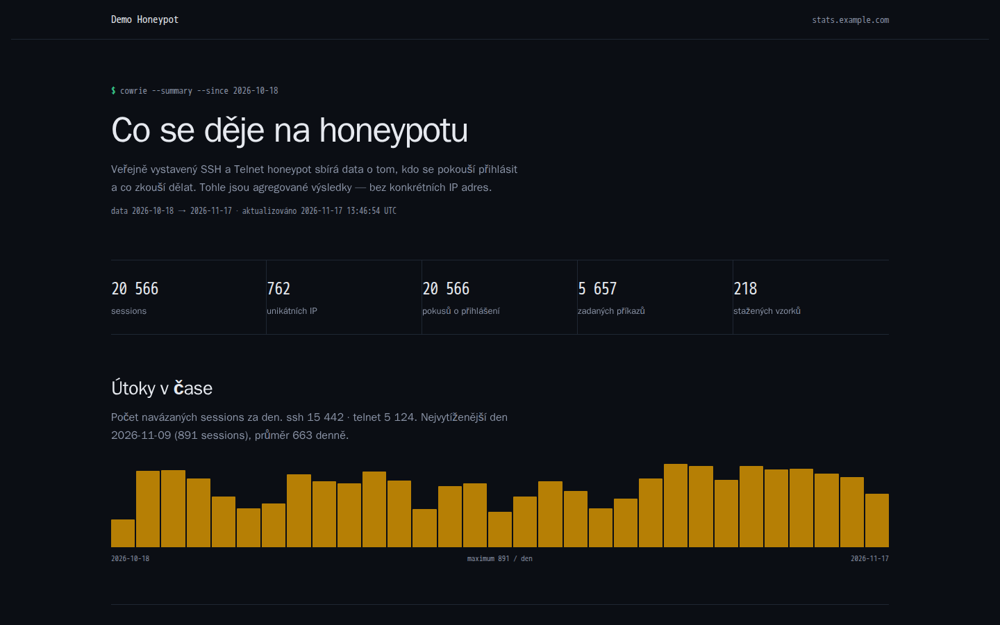

# cowrie-stats

Turn a [Cowrie](https://github.com/cowrie/cowrie) honeypot archive into a static
statistics page: attack timeline, countries, networks, credentials tried,
commands executed and malware sample counts.

No dependencies beyond Python 3.10+, no database server, no JavaScript on the
output page. It reads an SQLite archive read-only and writes plain HTML + JSON.

**Live example:** [attacks.laferrari.eu](https://attacks.laferrari.eu) — a real
deployment, ~320 000 sessions collected over 3.5 months.



## Why

Cowrie keeps one day per log file and rotates it. Most dashboards read only the
current `cowrie.json`, so every day the older attacks disappear from view. If you
first archive every event into SQLite (the schema this tool expects is in
[`schema.sql`](schema.sql)), you can ask questions that span months:

- How many attacks per day, and is it getting worse?
- Which countries and hosting providers send them?
- Which passwords do attackers try most often?
- What do they run once they think they are in?

This tool answers those questions and publishes the answers as a static page.

## Quick start

```bash
# 1) Synthetic archive: 30 days of fake attacks, no real data involved
python3 sample/make_sample.py --out sample.db --days 30

# 2) Generate the page
python3 generate.py --db sample.db --out out

# 3) Look at it
python3 -m http.server -d out 8000
# → http://127.0.0.1:8000
```

The first run downloads the free [DB-IP Lite](https://db-ip.com) databases
(~60 MB, cached for 30 days) to resolve countries and ASNs.

All IP addresses in the sample come from documentation-only ranges (RFC 5737),
so no real host is described as an attacker.

## Using it with your own archive

```bash
python3 generate.py --db /path/to/cowrie.db --out /var/www/stats
```

Expected tables are documented in [`schema.sql`](schema.sql). The important ones:

| Table | Used for |
|-------|----------|
| `events` | sessions, source IPs, timestamps, event types |
| `sessions` | session count |
| `auth` | usernames and passwords tried, success flag |
| `input` | commands typed into the fake shell |
| `files` | captured malware samples |

### Options

| Flag / env | Default | Meaning |
|-----------|---------|---------|
| `--db` | `$ARCHIVE_DB` | path to the SQLite archive |
| `--out` | `$REPORT_OUT` | output directory |
| `--no-fonts` | off | skip copying webfonts |
| `SITE_NAME` | `Honeypot` | name shown in header and footer |
| `SITE_URL` | – | link on the header name |
| `SITE_LABEL` | `cowrie-stats` | small label in the top right |
| `FONT_SRC` | `/fonts` | directory with the woff2 files |

Fonts are optional. If `FONT_SRC` is missing, the page falls back to system
fonts and looks slightly different but works the same.

## Output

```
out/
├── index.html    the page (no JavaScript)
├── data.json     all numbers as JSON, for other consumers
├── favicon.svg
└── fonts/        self-hosted Inter + JetBrains Mono, if available
```

`data.json` is stable enough to feed a dashboard or a bot:

```json
{
  "range": {"from": "2026-08-01T10:50:17Z", "to": "2026-11-17T11:51:58Z"},
  "totals": {"sessions": 320013, "ips": 15180, "logins": 273440},
  "geo": {"countries": [{"code": "US", "name": "USA", "share": 27.3}]},
  "top_usernames": [{"value": "root", "count": 188273}]
}
```

## What it publishes

Aggregates only. The page never contains individual source IP addresses — the
whole point is a summary safe to publish, not a feed of attacker addresses.
If you want per-IP data, query the archive directly.

## GeoIP

Country and ASN lookups use the free DB-IP Lite databases, licensed
[CC BY 4.0](https://creativecommons.org/licenses/by/4.0/). The generated page
includes the required attribution. Databases are refreshed automatically when
older than 30 days.

Only IPv4 is resolved. IPv6 ranges do not fit into SQLite's signed 64-bit
integers, and a honeypot on a single IPv4 address sees almost no IPv6 traffic.

## Scheduling

The generator is meant to run periodically — hourly is plenty:

```cron
15 * * * * python3 /opt/cowrie-stats/generate.py --db /var/lib/cowrie/cowrie.db --out /var/www/stats
```

## License

MIT — see [LICENSE](LICENSE).
